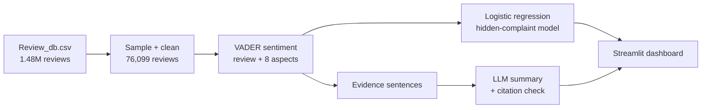

# TravelMood

**Finds the complaints that star ratings hide in Indian travel reviews.**

About 82% of reviews in the source data are rated 4–5★, so almost every destination looks excellent. TravelMood reads the review text instead. On 300 labelled 4–5★ reviews it detects hidden complaints with a **macro-F1 of 0.80**, against 0.69 for sentiment alone and 0.37 for the star rating alone.


<!-- Add a screenshot of the map or the compare tab here -->

## What it does

- Cleans and analyses **76,099 reviews of 51 Indian destinations**, sampled from a 1.48M-review dataset
- Scores sentiment for each review and for **8 aspects**: cleanliness, crowds, transport, safety, cost, food, scenery, stay
- Flags **hidden complaints**: 4–5★ reviews whose text complains about the place
- Writes **LLM summaries** per destination, with every citation checked against real review sentences
- **Streamlit dashboard**: map of India, side-by-side destination comparison, model results

## Architecture



## Pipeline

1. **Preprocessing:** remove HTML and links, drop duplicates and reviews under 5 words, keep ratings 1–5. Up to 1,500 reviews per destination, fixed random seed.
2. **Review sentiment:** VADER (NLTK) scores each review from −1 to +1.
3. **Aspect sentiment:** each sentence containing an aspect keyword is scored; below −0.2 counts as a complaint.
4. **Hidden-complaint model:** logistic regression with balanced class weights on TF-IDF (unigrams + bigrams), rating, VADER score, the 8 aspect scores, aspect flags, complaint count and review length.
5. **Grounded summaries:** rule-based facts and evidence sentences, rewritten by an LLM (Groq API) with numbered citations. Falls back to the rule-based summary if a citation check fails or no API key is set.

## Results

Evaluated on 300 labelled 4–5★ reviews (126 complaints, 174 clean) with 5-fold stratified cross-validation.

| Method | Macro-F1 |
|---|---|
| Rating only | 0.367 |
| Sentiment only (VADER < 0) | 0.685 |
| Transformer only (DistilBERT) | [fill in] |
| **TravelMood** | **0.801** |

For the complaint class: precision 0.77, recall 0.76.

## Project structure

| File | Role |
|---|---|
| `prep_review_db.py`, `data_prep.py` | Sample the source file and clean the reviews |
| `pipeline.py` | Sentiment and aspect scoring, hidden-complaint model, evaluation |
| `transformer_sentiment.py` | DistilBERT sentiment baseline |
| `label_tool.py` | Builds the labelling sheet and merges gold labels |
| `explain.py` | Rule-based summary, LLM rewrite and citation check |
| `compare.py`, `geo.py` | Destination score, verdict and coordinates |
| `app.py` | Streamlit dashboard |

## How to run

```bash
git clone https://github.com/hansikareddy01/[repo-name].git
cd [repo-name]
pip install -r requirements.txt

# Optional: LLM summaries
echo "GROQ_API_KEY=your_key_here" > .env

# Put Review_db.csv in data/ (see Dataset below), then:
python prep_review_db.py
python pipeline.py
python transformer_sentiment.py
streamlit run app.py
```

## Dataset

`Review_db.csv`: about 1.48M reviews of 14,494 places in 1,794 Indian cities. Not included in this repo because of its size. Download it from [source link] and place it in `data/`.

## Limitations

- The 300 gold labels were assigned by an LLM annotator, not fully validated by humans.
- Rating–text mismatch is a proxy for unmet expectations, not a direct measure.
- Aspects are keyword-based, so a complaint phrased without a keyword is missed.
- Many source reviews are truncated, and the dataset has no dates.

## Tech stack

Python · Pandas · NLTK (VADER) · Scikit-learn · DistilBERT (Hugging Face) · Groq LLM API · Streamlit · Plotly

## Author

C. Hansika Reddy · [GitHub](https://github.com/hansikareddy01)
